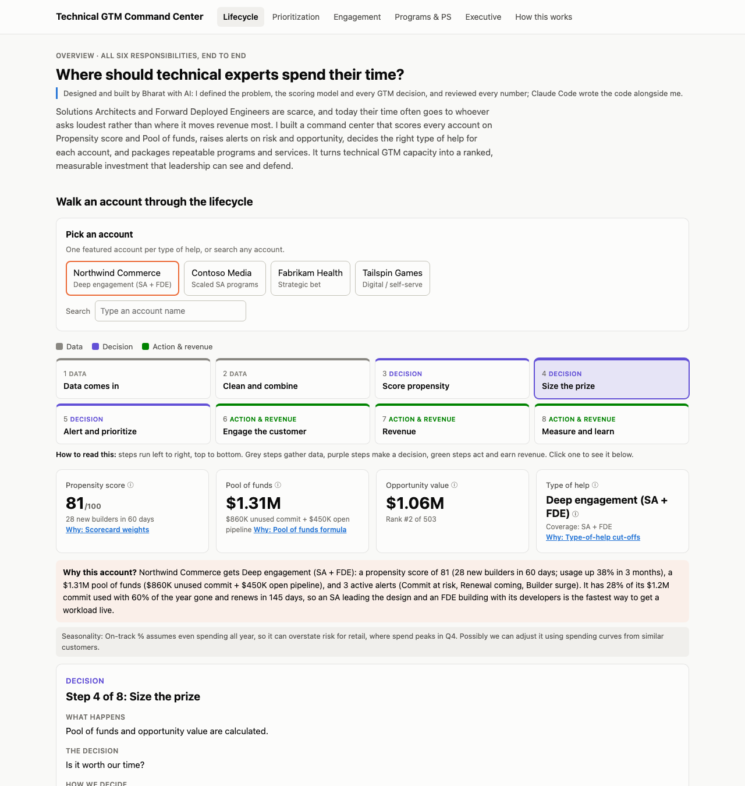

# Technical GTM Command Center

> **Synthetic data. Personal project, not affiliated with Cloudflare.**

Solutions Architects and Forward Deployed Engineers are a scarce resource, and their time often goes to whoever asks loudest rather than where it moves revenue most.
This project is a working command center that scores every account on propensity and pool of funds, flags risk and opportunity, routes each account to the right engagement motion, and packages repeatable programs and services.
It shows how technical GTM capacity can be run as a ranked, measurable investment that leadership can see and defend, with an interactive lifecycle tour that walks any account from CRM data to measured revenue.

**Live demo:** _coming soon_ — `https://<github-username>.github.io/technical-gtm-command-center/`



## Job responsibility → page

| Responsibility | What I built | Page |
|---|---|---|
| Prioritization & visibility | Propensity × pool of funds matrix, flags, capacity slider, ranked table with reasons | Prioritization |
| Strategic customer engagement | Engagement tracker: goal, owner, status, next step, joined to live scores | Engagement & Onsite |
| Technical onsites | Northwind onsite plan: agenda, attendees, prep, follow-ups, success metric | Engagement & Onsite |
| Technical programs | "Commit Burn Sprint" proactive SA playbook, triggered by a data flag | Programs & PS Offer |
| Professional Services packaging | "Workers Migration Accelerator" 3-tier offer + business case | Programs & PS Offer |
| Leadership visibility / ROI | Money in play, coverage, engagement health, holdout-based ROI plan | Executive view |

## How the score works

Every account gets a **propensity score (0–100)**: how likely it is to expand if we invest technical time. Each signal is converted to a percentile against all other accounts (so one outlier can't distort the scale), then weighted:

| Signal | Weight | Why it matters |
|---|---|---|
| Usage growth (90 days) | 35% | Workloads already moving onto the platform are the cheapest to accelerate |
| New developers (30 days) | 25% | New teams starting projects; early help shapes architecture |
| SA engagement (meetings, 90 days) | 20% | Warm relationship and known champions convert faster |
| Commit burn pace | 20% | Customers consuming ahead of schedule tend to expand at renewal |

The three signals that contributed most become **plain-English reasons** (e.g. "Usage +62% over the last 90 days (top 1% of accounts)") so a seller can repeat them.

Then:
- **Pool of funds** = unused commit + open pipeline → money available to unlock
- **Expected Value** = score / 100 × pool of funds → what we can realistically capture
- **Flags:** Commit at Risk (25%+ into contract, burning below 70% of pace), Renewal Window (≤120 days), Usage Spike (last 7 days ≥ 1.5× the 4-week average), New Developers (≥10 in 30 days)
- **Quadrant** (score ≥ 60, pool of funds ≥ $300K): FDE Deep Engagement (high/high), Scaled SA Program (high score/low value), Strategic Bet (low score/high value), Digital (low/low)
- **Rank** by Expected Value; current capacity covers the top 30

All weights and thresholds are at the top of [`pipeline.py`](pipeline.py) so they can be debated and changed in one place.

**Featured accounts** (one per quadrant, planted in the synthetic data; `pipeline.py` fails if any lands elsewhere):

| Account | Score | Pool of funds | Rank | Quadrant | Motion |
|---|---|---|---|---|---|
| Northwind Commerce | 80 | $1.31M | #2 | FDE Deep Engagement | Dedicated FDE engagement; Commit at Risk |
| Contoso Media | 92 | $79K | #171 | Scaled SA Program | Pooled office hours and templates |
| Fabrikam Health | 36 | $1.28M | #23 | Strategic Bet | Targeted exec + SA discovery |
| Tailspin Games | 30 | $10K | #472 | Digital | Docs, webinars, community |

Contoso is the instructive one: the highest score of the four, but too small a pool of funds to justify an FDE.

## How it's built

```
generate_data.py      → data/raw/accounts.csv            synthetic Salesforce + usage extract (seed 42)
pipeline.py           → data/processed/account_scores.csv scored mart table
                      → data/output/salesforce_writeback.csv fields pushed back to Salesforce (GTM_*__c)
                      → docs/data/accounts.json          read by the website
docs/data/content.json  hand-written engagement, onsite, program and PS offer copy
docs/                   static site (HTML/CSS/JS + Plotly.js), hosted on GitHub Pages
```

Python 3.11 + pandas. No database, no build tools. The folders mirror warehouse layers: raw → processed → output (write-back).

### Pages

Lifecycle (walkthrough) · Prioritization · Engagement · Programs & PS · Executive · Methodology (data flow + full job-description keyword mapping) · Decision Log (each judgment call: decision / why / possibly we can).

Every page has an ⓘ on each metric, column and term (one shared `docs/data/glossary.json`), a "How to read this" caption under each chart, slider and table, and "Why:" links to the matching Decision Log entry. Keyword mapping lives in `docs/data/jd_mapping.json`.

### How pages share state

The selected account and lifecycle step live in the URL, e.g. `prioritization.html?account=contoso-media&step=3#selected`. No cookies or browser storage, so any view can be bookmarked or shared.
- `account` is a slug built in `pipeline.py` (`northwind-commerce`); a unique prefix like `northwind` also works.
- Every page reads it on load, highlights that account, and adds it to the nav links so it follows you between pages.
- `step` is present when you arrive from the lifecycle walkthrough, and adds a "Back to lifecycle step N" link.
- Routing decisions (motion, program, PS tier) are computed once in `pipeline.py`, and step sentences are built once in `docs/assets/lifecycle.js`, so every page describes an account the same way.

### Run it

```bash
python3.11 -m venv .venv
.venv/bin/pip install -r requirements.txt
.venv/bin/python generate_data.py   # creates data/raw/accounts.csv
.venv/bin/python pipeline.py        # scores, exports, and checks the Northwind story
```

### Preview the site locally

The pages load JSON with `fetch()`, which browsers block when opening files directly, so serve the folder:

```bash
python3 -m http.server 8000 -d docs
```

Then open http://localhost:8000.

## Next steps with real Salesforce data

1. **Replace the scorecard with an ML model.** Train a propensity model (e.g. logistic regression or gradient boosting in scikit-learn) on historical accounts labelled by whether they expanded, and validate on a held-out time period. Keep the reason codes, generated from feature contributions.
2. **Real usage data.** Join daily product telemetry (requests, compute, products adopted, developer sign-ups) from the warehouse instead of synthetic snapshots, and recompute flags on a schedule.
3. **Holdout test to prove ROI.** Randomly hold out a share of eligible accounts from the SA program and PS outreach, then compare burn recovery, expansion and renewal rates between treated and holdout groups. Report only the incremental lift as ROI, not before-vs-after, which overcounts.
4. **Close the loop in Salesforce.** Load `salesforce_writeback.csv` into custom Account fields, and feed engagement outcomes back as training labels.

---

All company and person names are fictional. No Cloudflare logos or branding are used.
